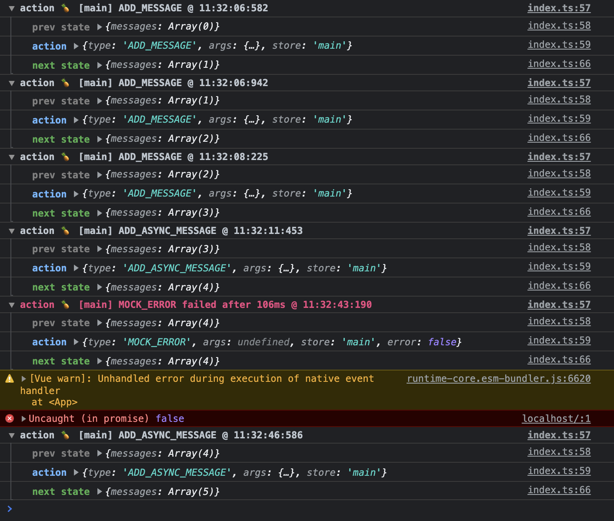

# pinia-logger

Logs Pinia actions to the console: the state before, the action with its arguments and result, and the state after. An optional plugin does the same for Pinia Colada queries and mutations.



## Install

```bash
npm install --save-dev pinia-logger
```

Works with Pinia 2, 3 and 4, on Vue 2.7 or Vue 3.2 and later. ESM and CommonJS builds are included; the CommonJS build of `pinia-logger/colada` needs a Node version that can `require()` ES modules (20.19 or 22.12 and later), because `@pinia/colada` ships only ESM. Pinia Colada support needs `@pinia/colada` 0.12 or later; mutation logging needs 0.17.9 or later.

## Stores

```ts
import { createApp } from "vue";
import { createPinia } from "pinia";
import { PiniaLogger } from "pinia-logger";

const pinia = createPinia();
pinia.use(
  PiniaLogger({
    expanded: false,
    showDuration: true,
    filter: ({ name }) => name !== "incrementCounter",
  }),
);
createApp(App).use(pinia);
```

Override the options for one store, or turn it off with `logger: false`:

```ts
export const useCounterStore = defineStore("counter", {
  state: () => ({ counter: 0 }),
  actions: {
    incrementCounter() {
      this.counter++;
    },
    decrementCounter() {
      this.counter--;
    },
  },
  logger: { actions: ["decrementCounter"] },
});

export const useSetupStore = defineStore(
  "setup",
  () => {
    const count = ref(0);
    const increment = () => count.value++;
    return { count, increment };
  },
  { logger: false },
);
```

## Pinia Colada

```ts
import { PiniaColada } from "@pinia/colada";
import { PiniaColadaLogger } from "pinia-logger/colada";

app.use(PiniaColada, {
  plugins: [PiniaColadaLogger({ filter: ({ type }) => type !== "hit" })],
});
```

It logs one group per event, titled with the query or mutation key:

| Event        | When                                                                     |
| ------------ | ------------------------------------------------------------------------ |
| `fetch`      | A query ran, with the resulting state. `failed` or `cancelled` on error. |
| `hit`        | `refresh()` returned fresh cached data without fetching.                 |
| `set`        | `setQueryData()` wrote data.                                             |
| `invalidate` | A query was invalidated.                                                 |
| `remove`     | A query left the cache.                                                  |
| `mutate`     | A mutation ran, with its variables and result. `failed` on error.        |

Colada's internal stores are skipped by the store logger.

## Nuxt

Nuxt 3 and 4 with `@pinia/nuxt` (tested on Nuxt 3.21 and 4.6):

```ts
export default defineNuxtConfig({
  modules: ["@pinia/nuxt", "pinia-logger/nuxt"],
  piniaLogger: { expanded: false },
});
```

The logger runs in the browser only. Options pass through the public runtime config, so `filter` and `logger` (functions) cannot be set here; use per-store options instead.

## Options

| Option          | Default                  | Store | Colada | Description                                                                    |
| --------------- | ------------------------ | :---: | :----: | ------------------------------------------------------------------------------ |
| `disabled`      | `true` in production     |   x   |   x    | Turn the logger off. Production means `process.env.NODE_ENV === "production"`. |
| `expanded`      | `true`                   |   x   |   x    | `console.group` instead of `console.groupCollapsed`.                           |
| `showDuration`  | `false` (Colada: `true`) |   x   |   x    | Append `in 12ms`.                                                              |
| `showTime`      | `true`                   |   x   |   x    | Append `@ 14:03:07.042`.                                                       |
| `showPineapple` | `true`                   |   x   |   x    | Put 🍍 in the title.                                                           |
| `logErrors`     | `true`                   |   x   |   x    | Log failed actions, fetches and mutations.                                     |
| `logger`        | `console`                |   x   |   x    | Any object with `log`, `group`, `groupCollapsed`, `groupEnd`.                  |
| `showStoreName` | `true`                   |   x   |        | Put `[storeId]` in the title.                                                  |
| `actions`       | all                      |   x   |        | Log only these action names.                                                   |
| `filter`        | all                      |   x   |   x    | Store: `(action) => boolean`. Colada: `({ type, key }) => boolean`.            |

State is copied when the action starts and when it ends, so the console shows both versions even when nested objects change. Plain objects and arrays are copied; `Map`, `Set`, `Date` and class instances are logged by reference.

## Migrating from 1.x

- All option names are unchanged.
- `disabled` now defaults to `true` in production. Pass `disabled: false` to keep logging there.
- The default export is gone: `import { PiniaLogger } from "pinia-logger"`.
- The Nuxt module moved from `pinia-logger-nuxt` to `pinia-logger/nuxt`. Nuxt 2 and Nuxt Bridge are no longer supported.
- Per-store `actions` is typed as `string[]`; the 1.x action-name type broke option-store type inference (seen with Pinia 4 and TypeScript 7).
- `filter` now runs when the action starts, so a filtered action no longer copies state.
- With `showDuration`, successful actions also show their duration. Failed actions read `failed in 12ms` instead of `failed after 12ms`.
- The time is `HH:MM:SS.mmm` with zero-padded milliseconds, so the screenshot above shows the 1.x format.
- The `action` row shows `args` as an array and adds `result` when the action returns a value.

## Changelog

See [CHANGELOG.md](CHANGELOG.md).
